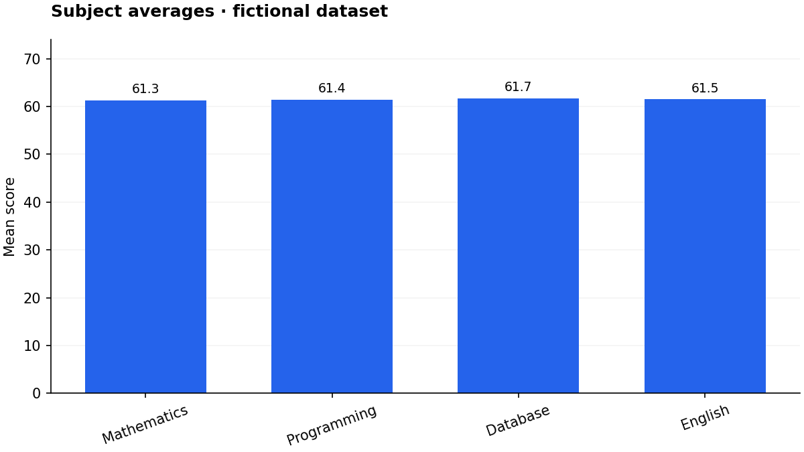

# Student Academic Dashboard

This project is a straightforward dashboard for looking at student performance, subject trends, and a few quality checks in the data without making the numbers feel overwhelming.

## Project overview

You can upload a student CSV or use the built-in fictional dataset. The dashboard has five sections, lets you filter by cohort, checks individual records, highlights patterns, and makes it easy to export the results.

## Why this exists

School data is rarely clean on the first pass. Missing values, duplicate rows, and inconsistent entries are common. This project helps turn that raw information into something more usable while keeping the quality issues visible, so the numbers are easier to interpret without pretending they are perfect.

## Features

- Five sections: Overview Dashboard, Student Analysis, Subject Analysis, Performance Insights and Dataset Explorer.
- KPIs: student count, average score, average attendance, pass rate and highest score.
- Filters: department, semester, gender, grade, attendance range and pass/fail status.
- Eight chart types/views: grade distribution, pass/fail distribution, subject averages, department performance, semester performance, attendance vs score, study time vs score and top students.
- UTF-8 CSV upload (10 MB maximum), missing-column validation, empty-data handling and filtered CSV downloads.
- Cleaning audit, numeric imputation flags, repeatable generator and exploratory notebook.
- Unit tests for integrity, grading boundaries, risk logic, invalid data and safe exports.

## Technologies

Python 3.11/3.12, Pandas, NumPy, Matplotlib and Streamlit. Notebook execution additionally requires Jupyter or a compatible VS Code extension. Runtime dependencies are in `requirements.txt`.

## Project structure

```text
student-academic-dashboard/
├── app.py
├── data/student_performance.csv
├── notebooks/student_analysis.ipynb
├── src/
│   ├── __init__.py
│   ├── data_cleaning.py
│   ├── analysis.py
│   └── visualizations.py
├── scripts/generate_dataset.py
├── tests/ (test_pipeline.py, test_app.py)
├── .streamlit/config.toml
├── requirements.txt
├── README.md
├── RUN_AND_GITHUB_GUIDE.md
└── .gitignore
```

## How the modules work

1. **`src/data_cleaning.py`:** `load_csv()` preserves identifiers as text; `clean_data()` validates the schema, removes duplicate records, normalizes score units, converts types, checks ranges, imputes numeric values and returns a `CleaningReport`.
2. **`src/analysis.py`:** `calculate_performance()` adds weighted scores, grades, status and risk reasons. Other functions calculate summaries, grouped performance, correlations and CSV exports.
3. **`src/visualizations.py`:** reusable bar and scatter chart functions return Matplotlib figures. Callers close figures after rendering.
4. **`app.py`:** owns sidebar controls, user feedback and presentation. Business rules remain in reusable modules.
5. **Notebook:** reuses those same functions to avoid a second, inconsistent implementation.

## Setup instructions

Extract the ZIP and open the folder containing `app.py` in VS Code or another editor. Use Python 3.11 or 3.12.

```bash
python -m venv .venv
```

Windows PowerShell activation:

```powershell
.venv\Scripts\Activate.ps1
```

macOS/Linux activation:

```bash
source .venv/bin/activate
```

Then:

```bash
pip install -r requirements.txt
streamlit run app.py
```

Open the Local URL printed in the terminal, usually `http://localhost:8501`. Stop with Ctrl+C. If activation is blocked or a command is not recognized, see `RUN_AND_GITHUB_GUIDE.md` for direct virtual-environment commands.

## Testing and notebook

Run from the project root:

```bash
python -m unittest discover -s tests -v
```

Open the notebook with the VS Code Jupyter extension, or optionally install notebook tools:

```bash
python -m pip install jupyter ipykernel
python -m jupyter notebook notebooks/student_analysis.ipynb
```

Select the same virtual environment as the notebook kernel.

## Dataset and data dictionary

All records are fictional and contain no real personal information. There are **244 raw rows, 240 unique student IDs and 18 columns**. Four exact duplicates and eleven deliberately defective cells support the next cleaning milestone. Do not interpret raw averages as cleaned results.

| Column(s)                                                           | Meaning / intended valid values                                              |
| ------------------------------------------------------------------- | ---------------------------------------------------------------------------- |
| student_id                                                          | Unique fictional identifier; required                                        |
| name                                                                | Fictional display label                                                      |
| gender                                                              | Female, Male, Non-binary; missing values will be Unknown                     |
| age                                                                 | Whole years, 16–100                                                          |
| department                                                          | Computer Science, Software Engineering, Information Technology, Data Science |
| semester                                                            | Integer 1–8                                                                  |
| attendance_percentage                                               | Numeric 0–100                                                                |
| assignment_score, quiz_score, midterm_score, final_exam_score       | Numeric 0–100                                                                |
| mathematics_score, programming_score, database_score, english_score | Numeric 0–100                                                                |
| study_hours_per_week                                                | Numeric 0–168                                                                |
| extracurricular_activity                                            | Yes or No; missing values will be Unknown                                    |
| previous_gpa                                                        | Numeric 0–4                                                                  |

Controlled defects: three blanks; two nonnumeric tokens (`absent`, `twenty`); five out-of-range values; one unit-bearing score (`85 points`); four exact duplicate rows. Cleaning choices and counts will be documented in Stage 2. Uploads containing real records should not be committed to GitHub.

## Cleaning policy

- Normalize column names to lowercase with underscores; reject missing or duplicate normalized names. Extra uploaded columns are ignored.
- Trim text, remove exact duplicate rows, drop rows missing IDs, then keep the first record for conflicting IDs. The audit reports these sequential counts.
- Convert numeric types; accept explicit numeric score strings such as `85 points`. Reject arbitrary tokens, infinities, out-of-range values and fractional ages/semesters.
- Impute blanks and invalid numeric values with the valid **full loaded dataset's** column median. Round the median for integer fields. This is descriptive analysis, not a predictive train/test pipeline.
- Entirely invalid columns use defaults: age 20, semester 1, attendance 75, scores 50, study hours 10, GPA 2. These are demonstration defaults, not recovered facts.
- Missing names/departments and unsupported categories become `Unknown`. Department labels are trimmed but not merged using fuzzy matching.
- Preserve row flags: `imputed_numeric_count`, `score_imputed`, `attendance_imputed`.
- The raw CSV is never overwritten; cleaning and scoring return new frames. Uploads are processed by the running app and are not saved to project files. On reruns, the input is reprocessed; no persistent student database is used.

## Scoring, grades and risk

| Component                                              | Weight |
| ------------------------------------------------------ | -----: |
| Assignment                                             |    15% |
| Quiz                                                   |    10% |
| Midterm                                                |    20% |
| Final exam                                             |    30% |
| Mean of mathematics, programming, database and English |    25% |

Each subject contributes 6.25%. Weights sum to 100%. Scores use a 0–100 scale. This is an explicit demonstration rubric; real institutions may use different weights or overlapping assessments.

| Grade | Score       |
| ----- | ----------- |
| A     | ≥90         |
| B     | ≥80 and <90 |
| C     | ≥70 and <80 |
| D     | ≥60 and <70 |
| E     | ≥50 and <60 |
| F     | <50         |

Pass means score ≥50. Academic risk means attendance <75% **or** score <50. Both conditions appear in the reason if applicable. Grade decisions use unrounded values; UI rounding can visually hide a boundary. Rows with imputed inputs are flagged because estimates can change ranks or risk indicators.

## Screenshots

The `screenshots/` directory contains an actual exported subject chart. To document the running interface, launch the app, capture Overview, Student Analysis and the quality audit, and add those screenshots here. No full browser screenshots are included in this package.



## Key insights

See `PROJECT_RESULTS.md` for automatically calculated results on the bundled, cleaned fictional dataset. All relationships are simulated; the generator deliberately shares variation among attendance, study time and academic scores. Correlations cannot establish causation, and the dataset cannot support claims about real students or demographic groups. Group sizes and imputation flags should accompany comparisons.

## Deployment instructions

1. Push the extracted project contents to GitHub using the companion guide.
2. Sign in to Streamlit Community Cloud and connect GitHub.
3. Create an app and select your repository and branch, with main file path `app.py`.
4. In Advanced settings choose Python 3.12, then deploy.

Keep `requirements.txt`, `.streamlit/config.toml`, `src/` and the bundled data in the repository. No secrets are needed. This project requires a Python Streamlit host; GitHub Pages and Sites do not execute its Python server. No remote repository or live deployment is included.

Official instructions: https://docs.streamlit.io/deploy/streamlit-community-cloud/deploy-your-app/deploy

## GitHub and portfolio

See `RUN_AND_GITHUB_GUIDE.md` for copyable commands and troubleshooting. Suggested repository description: “Interactive academic performance dashboard with auditable data cleaning, weighted scoring, cohort filters and reusable Python analytics.”

Suggested CV bullet, after you have reviewed and run the project: “Built a modular Python/Streamlit dashboard using Pandas, NumPy and Matplotlib, with CSV validation, weighted academic scoring, interactive cohort filters and academic risk indicators.”

## Future improvements

Configurable institutional rubrics, exclusion-versus-imputation controls, longitudinal cohorts, accessible chart alternatives, richer statistical uncertainty reporting and downloadable PDF reports. Predictive features would require suitable data, consent and validation.
